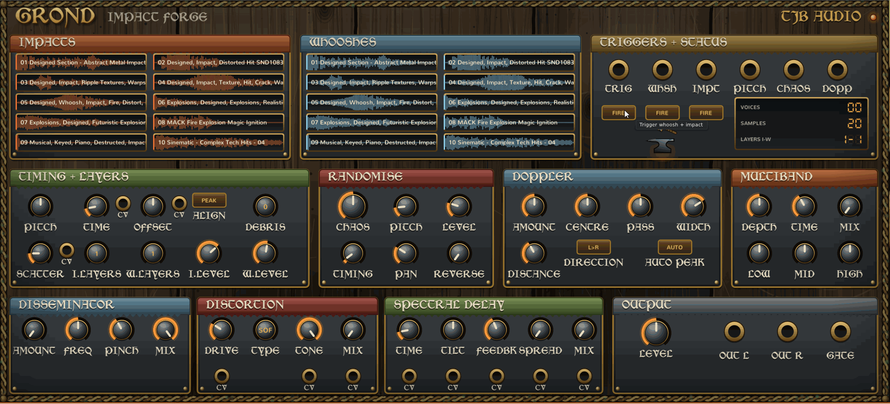

I've been using VCV as a tool for audio design in games for some time now. Felt like it was about time to get some interesting tools on the go. Built with assistance from Claude code, my C++ is still a bit shakey so bear with me 

# Grond (VCV Rack 2)

**THE IMPACT FORGE** - a layering environment for generating whooshes. Load your own WAVs into two banks
(10 impact slots and 10 whoosh slots) and every trigger builds a layered whoosh -> impact -> debris event.
Comes with built-in Multiband (OTT), Doppler, Disseminator (Disperser), Distortion and Spectral Delay.

Grond ships with no samples: bring your own WAV files.

## Quick start
1. Add **Grond** to your patch (brand: TJB Audio, tag: Effect).
2. Drag WAV files onto the IMPACTS or WHOOSHES section, or click a slot and choose *Load WAV...*.
   Right-click the module -> *Load WAV folder into IMPACTS / WHOOSHES* fills a whole bank from one folder.
   Sample paths are saved with the patch.
3. Press a **FIRE** button, or send a trigger to **TRIG** (whoosh then impact), **WHSH** (whoosh only) or **IMPT** (impact only).
   The little hammer on the anvil strikes whenever any of them fires.

## Controls

### Timing + layers
| Control | Does |
|---|---|
| PITCH | Global pitch in semitones (varispeed). The PITCH jack is 1 V/oct. |
| TIME | Whoosh-to-impact delay when ALIGN is MAN. |
| OFFSET | Nudges the impact earlier or later (+-500 ms). |
| ALIGN | Where the impact lands: MAN (TIME), PEAK (the whoosh's loudest point) or END (the end of the whoosh). |
| DEBRIS / SCATTER | Number of extra, quieter, higher hits after the main impact, and the window they are scattered over. |
| I.LAYERS / W.LAYERS | How many different samples of that type (1-4) play together on each trigger. Layers are level-scaled. |
| I.LEVEL / W.LEVEL | Impact and whoosh levels. |

Each trigger picks random slots of the right type and avoids repeating the same first slot when it can.

### Randomise
**CHAOS** scales all of the following (its CV jack adds to it): PITCH (+-semitones), LEVEL (+-dB), TIMING (jitter on impact time),
PAN, and REVERSE (probability that a whoosh plays backwards, which makes risers).

### Doppler (whooshes)
Models a source flying past: pitch falls as it passes, level follows distance, the sound pans across and loses highs when far.
AMOUNT (CV jack too), CENTRE (shifts the closest-approach moment), PASS (gentle to abrupt), WIDTH (stereo travel),
DISTANCE (level and air loss), DIRECTION (L>R, R>L, random), AUTO PEAK (centre the pass on the sample's loudest part).
Right-click menu: *Apply doppler to impacts too*.

### Effects (series: Disseminator -> Distortion -> Spectral Delay -> Multiband)
- **Disseminator** (disperser): up to 32 cascaded allpass stages around FREQ; PINCH narrows the band. Turns transients into chirps and zaps.
- **Distortion**: Soft (tanh), Hard clip, Fold, Crush (bit and rate reduction), with TONE low-pass and MIX.
- **Spectral Delay**: STFT with a separate delay and feedback per frequency band. TIME is the longest delay (about 2 s),
  TILT makes lows (-) or highs (+) arrive later, SPREAD scatters delays per band. The wet signal has about 21 ms latency.
- **Multiband**: three-band (below 120 Hz, mid, above 2.5 kHz) upward and downward compressor in the style of OTT.
  DEPTH sets the squeeze and lift, TIME scales attack and release, LOW / MID / HIGH are band gains, MIX is a parallel blend.

All effect mixes default to off.

### CV inputs
Small CV jacks sit by TIME, OFFSET and SCATTER (read when a trigger fires), by DRIVE, TONE and MIX on the distortion, and under all
five Spectral Delay knobs. 10 V sweeps the parameter's full range and is added to the knob position.

### Outputs
OUT L / OUT R (L carries a mono mix if R is unplugged) and GATE, which fires when the main impact starts.

## Limits
- WAV only: PCM 8/16/24/32-bit and float 32/64, mono or stereo (first two channels used), up to 2 minutes each.
- 32 voices; the oldest are stolen first.
- ALIGN uses the nominal whoosh length, so strong doppler moves the real landing point slightly; use OFFSET to correct.
- Distortion is not oversampled, so Hard / Fold / Crush will alias.

## Building from source
Needs the Rack 2 SDK and a compiler. On Windows with MSYS2 (MinGW 64-bit) installed in `C:\msys64`, set the `RACK_DIR` environment variable to your SDK folder and run `build.bat`. Elsewhere: `export RACK_DIR=/path/to/Rack-SDK && make install`.

## License
GPL-3.0-or-later, see `LICENSE.txt`.

### Fonts
The panel lettering is set in Morris Roman (1001fonts.com Free For Commercial Use licence, which allows commercial use of
the lettering but not redistributing the font). The font file is not included: the text ships as pre-rendered images in
`res/text/`, made with `tools/gen_text.cpp`. Text without an image falls back to Rack's bold font. Rack's bundled Nunito, Share Tech Mono and DSEG fonts
are used for other text.
